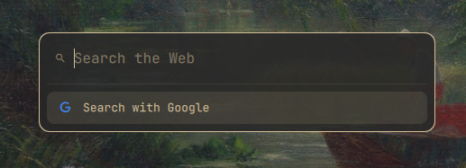

# Web Search — an Omarchy plugin

A compact launcher to search the web or open a URL, opened with a keyboard shortcut. Inspired by the Zen Browser search bar, but smaller, and styled with the active Omarchy theme.



## Features

- **Site keywords:** type `yt` and press Space or Tab, and a "YouTube" tag appears. Whatever you type next is searched on YouTube.
- **Open URLs directly:** `https://...`, `github.com/foo`, `localhost:5173` or `192.168.0.1:8080` + Enter opens the address.
- **Your choice of browser:** opens in the browser you set (Zen, Firefox, Chromium...), independent of the system default. You can also pick a browser per site.
- **Configurable sites:** add, change or remove sites in a JSON file that reloads on save.
- **Follows the Omarchy theme:** background, text, border and screen dimming come from the active theme and change with it.
- **No network access:** the plugin never touches the internet. Only the browser does, when you open something.
- **Translated:** English and Brazilian Portuguese, following the language selected in Omarchy.

## Requirements

- Omarchy with the Quickshell-based shell (`omarchy-shell`), the version with plugins in `~/.config/omarchy/plugins/`.
- A Nerd Font for the icons. Omarchy ships with JetBrainsMono Nerd Font.
- Optional: `notify-send`, for the notice shown when the configured browser is not found.

## Installation

```sh
omarchy plugin add https://github.com/gusmezomo/omarchy-websearch.git --enable
```

This clones the plugin into `~/.config/omarchy/plugins/gusmezomo.websearch` and enables it in the shell.

Then add a keyboard shortcut and, optionally, choose a browser.

### Add a keyboard shortcut

Plugins can't register shortcuts themselves, so add this to `~/.config/hypr/bindings.lua`:

```lua
o.bind("SUPER + CTRL + G", "Web search", "omarchy-shell shell toggle gusmezomo.websearch")
```

Then check that the config loaded without errors:

```sh
hyprctl reload && hyprctl configerrors
```

See [Changing the shortcut](#changing-the-shortcut) to use a different key combination.

### Choose a browser (optional)

Create `~/.config/omarchy/websearch.json`:

```json
{
  "browser": ["zen-browser"]
}
```

Without this file, the plugin opens links in the system default browser (`xdg-open`).

### Update and remove

```sh
omarchy plugin update gusmezomo.websearch
omarchy plugin remove gusmezomo.websearch
```

Removing the plugin leaves your `~/.config/omarchy/websearch.json` and the shortcut in `bindings.lua` in place; delete them by hand if you no longer want them.

## Usage

| Action | Key |
|---|---|
| Open / close | your shortcut (e.g. `SUPER + CTRL + G`) |
| Activate a site tag | type the exact keyword + `Space` or `Tab` |
| Remove the tag | `Backspace` with an empty field |
| Move through the list | `↑` / `↓` |
| Open the selected item | `Enter` or click |
| Close | `Esc` or click outside the box |

**Behavior details:**
- **Exact keyword:** the tag only appears for the exact keyword. `yt` becomes a tag, but `YT` and `yt2` don't. When the text matches a keyword, the list shows a "Use YouTube [Tab]" hint.
- **No tag:** the search goes to the default site (Google).
- **With a tag:** the text is always searched on the tagged site, even if it looks like a URL.
- **Tag with an empty field:** Enter opens the site's home page.
- **Text that looks like a URL:** the first item opens the address and the second searches for the text. Press `↓` + Enter to search instead of opening.
- **After opening something:** the box closes by itself.

### Built-in sites

| Keyword | Site |
|---|---|
| `g` | Google (default) |
| `yt` | YouTube |
| `gh` | GitHub |
| `red` | Reddit |
| `tr` | Google Translate (translates into Portuguese) |
| `x` | X (Twitter) |

## Configuration

All personal settings live in **`~/.config/omarchy/websearch.json`**. The file is optional, and the plugin reloads it on save, with no shell restart needed.

The default sites are in `sites.json`, inside the plugin. Don't edit that file: your changes would be lost when you update the plugin. Use your own `websearch.json`, which only needs to list what you want to change.

Full example:

```json
{
  "browser": ["zen-browser"],
  "defaultSite": "g",
  "sites": {
    "ddg": {
      "name": "DuckDuckGo",
      "url": "https://duckduckgo.com/?q=%s",
      "color": "#DE5833"
    },
    "yt": { "browser": ["chromium"] },
    "red": null
  }
}
```

### `browser`: which browser to use

The command that opens the browser, written as a **list** (one argument per item). The plugin appends the URL at the end.

```json
"browser": ["zen-browser"]
"browser": ["firefox"]
"browser": ["chromium"]
"browser": ["zen-browser", "--private-window"]
"browser": ["firefox", "-P", "Work"]
"browser": ["chromium", "--profile-directory=Profile 1"]
```

- **Empty or missing:** uses the system default browser (`xdg-open`).
- **Command not found:** opens in the default browser and shows a notification.
- **Browser already running:** the URL usually opens in a new tab of the existing window.
- **Finding the command:** look at the `Exec=` line of the browser's `.desktop` file, e.g. `/usr/share/applications/zen.desktop`, or run `which zen-browser`.

The command runs directly, without going through a shell, so typed text is never interpreted as a command.

### `defaultSite`: site used without a tag

The keyword of the site used when there's no tag. Defaults to `"g"` (Google).

```json
"defaultSite": "ddg"
```

### `sites`: add, change and remove sites

Each key is the site's **keyword**: letters and digits, up to 12 characters, case-sensitive.

**Add a site:** give at least `name` and `url`.

```json
"sites": {
  "wiki": {
    "name": "Wikipedia",
    "url": "https://en.wikipedia.org/w/index.php?search=%s"
  }
}
```

**Change an existing site:** give only the fields that change. The rest comes from the default.

```json
"sites": {
  "tr": { "url": "https://translate.google.com/?sl=auto&tl=en&text=%s&op=translate" }
}
```

**Remove a default site:** set it to `null`.

```json
"sites": {
  "red": null
}
```

**Change a site's keyword:** remove the old one and create the new one.

```json
"sites": {
  "yt": null,
  "y": { "name": "YouTube", "url": "https://www.youtube.com/results?search_query=%s" }
}
```

#### Site fields

| Field | Required | Description |
|---|---|---|
| `name` | yes | Name shown on the tag and in the list (up to 40 characters). |
| `url` | yes | Search URL, with `%s` where the query goes. Must start with `https://` or `http://`. |
| `home` | no | Page opened with a tag and an empty field. Defaults to the domain of `url`. |
| `icon` | no | Nerd Font icon (see below). Without one, a magnifier is shown. |
| `color` | no | Icon color in hex (`#RRGGBB`). Without one, the theme's text color is used. |
| `browser` | no | Browser for this site only, in the same format as the global `browser`. |

**Finding a site's search URL:** search for any word on the site, copy the URL from the address bar and replace the word with `%s`.

Sites with an invalid `url`, without `%s`, or with an invalid keyword are ignored. If the JSON has a syntax error, the plugin uses only the default sites until you fix it.

#### Icons

The `icon` field takes a single Nerd Font character. Find the icon at <https://www.nerdfonts.com/cheat-sheet> and paste the character straight into the JSON:

```json
"icon": "󰇥"
```

Material Design icons (`nf-md-*`) tend to look the most consistent.

### Changing the shortcut

Edit the `o.bind` line in `~/.config/hypr/bindings.lua`, for example:

```lua
o.bind("SUPER + ALT + SPACE", "Web search", "omarchy-shell shell toggle gusmezomo.websearch")
```

- **Shortcut already taken:** if the combination is already bound to a default Omarchy action, free it first with `hl.unbind("SUPER + ALT + SPACE")` on a line above.
- **List shortcuts in use:** `omarchy menu keybindings --print`.
- **Apply:** `hyprctl reload && hyprctl configerrors`.

#### Example: use `SUPER + SHIFT + SPACE`

By default, Omarchy uses `SUPER + SHIFT + SPACE` to show and hide the top bar. If you don't use that, you can free the combination and give it to the web search:

```lua
hl.unbind("SUPER + SHIFT + SPACE")
o.bind("SUPER + SHIFT + SPACE", "Web search", "omarchy-shell shell toggle gusmezomo.websearch")
```

The first line removes Omarchy's top bar toggle from the shortcut. The second binds the same keys to this plugin.

The command `omarchy-shell shell toggle gusmezomo.websearch` also works outside the shortcut, from a script or the terminal.

### Appearance

The box uses the menu colors of the active theme (`[menu]` in the Omarchy theme): background, text, border and screen dimming. To change the colors, customize the theme (see `omarchy theme --help`). The plugin has no hard-coded colors.

The box opens on the focused monitor.

## Troubleshooting

**The shortcut does nothing.**
- Check that the plugin is installed and enabled with `omarchy plugin list`; enable it with `omarchy plugin enable gusmezomo.websearch`.
- Run `omarchy-shell shell toggle gusmezomo.websearch` in a terminal to rule out a shortcut problem.
- Run `hyprctl configerrors` to see errors in the Hyprland config.

**I changed the `.qml` and nothing happened.** The shell sometimes keeps the old version cached. Run `omarchy restart shell`.

**See the plugin's errors:**

```sh
journalctl --user -b --no-pager | grep -i websearch
```

**It opens in the wrong browser.** Check `browser` in `websearch.json` and that the command exists (`which <command>`). A "Browser not found" notification means the command wasn't found.

**A site I added doesn't show up.** Check that its `url` starts with `https://` and contains `%s`, and that the keyword has only letters and digits.

## Development

```
gusmezomo.websearch/
├── manifest.json        # plugin manifest (overlay kind)
├── WebSearch.qml        # UI: box, tag, list, keyboard handling
├── Logic.js             # URL/keyword detection, config, open command
├── sites.json           # default sites
├── i18n/                # translations (en, pt-BR)
├── docs/                # README images
└── tests/logic.test.js  # logic tests
```

To work on the plugin from a clone elsewhere, symlink it into the plugins folder (the folder name must match the `id` in `manifest.json`) and enable it:

```sh
ln -s ~/path/to/omarchy-websearch ~/.config/omarchy/plugins/gusmezomo.websearch
omarchy plugin enable gusmezomo.websearch
omarchy plugin validate ~/path/to/omarchy-websearch
```

`Logic.js` has no QML dependencies. The tests run with Node:

```sh
node tests/logic.test.js
```

To add a language, create `i18n/<code>.json` with the same keys as `en.json`. Accepted codes are Omarchy's (`$OMARCHY_PATH/default/i18n/locales.json`).

## Roadmap

- History of recent searches.
- Suggestions while typing.

## License

[MIT](LICENSE)
